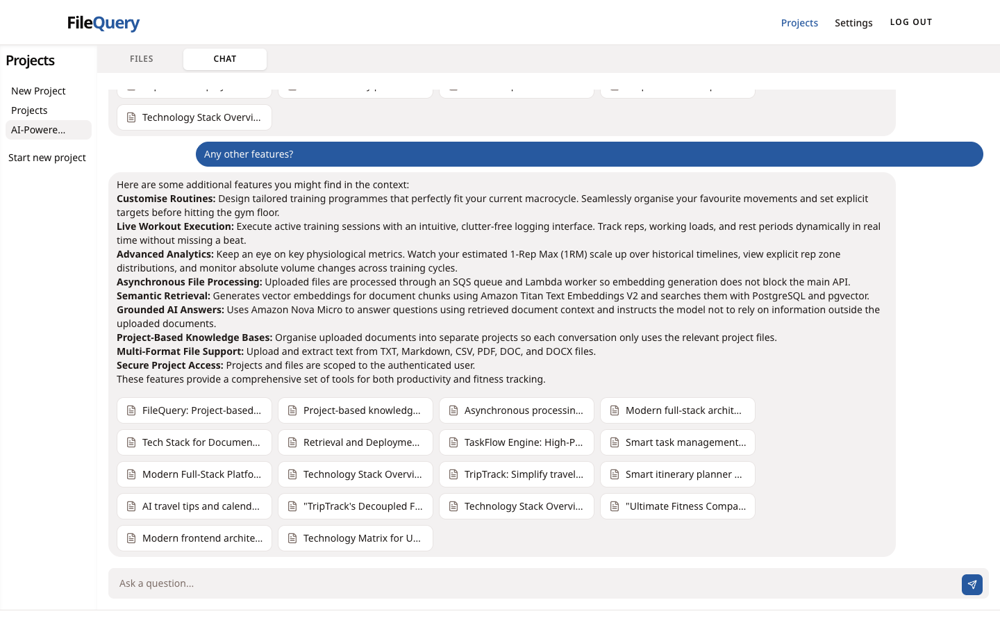
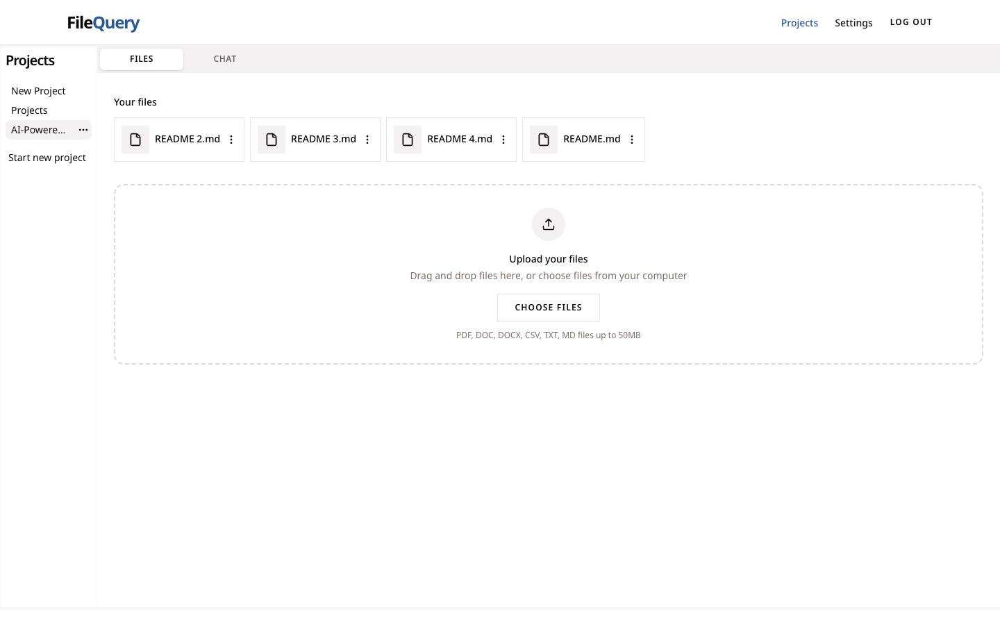
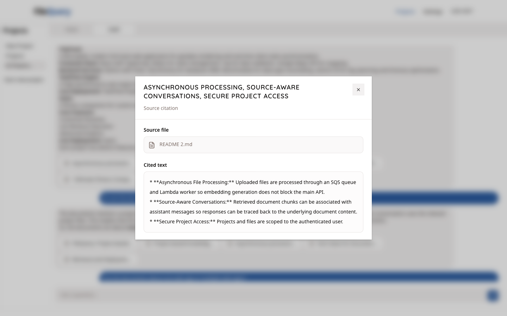
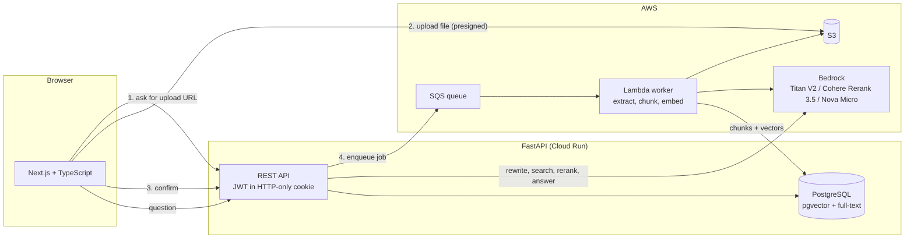

# FileQuery

Upload your documents into a project, then ask questions in plain language. Every answer comes with the passages it was based on, and when the documents do not contain the answer, FileQuery says so instead of guessing.

**[Live demo](https://file-query-frontend-752853711822.europe-west1.run.app/)** · [CI workflow](.github/workflows/ci.yml)



<table>
  <tr>
    <td><br><sub>Projects and files</sub></td>
    <td><br><sub>Open a source to see the cited text</sub></td>
  </tr>
</table>

## What it does

* **Project knowledge bases:** group documents into projects so each conversation only draws on the files you chose.
* **Six file types:** TXT, Markdown, CSV, PDF, DOC and DOCX.
* **Answers with sources:** replies link back to the passages they came from, so you can check them.
* **Follow-up questions:** "What about the other one?" works, because the question is rewritten using the conversation so far.
* **Refuses when unsure:** if retrieval finds no evidence, the answer says so and cites nothing.
* **Private by default:** projects and files are scoped to the signed-in user, and uploads go straight to storage rather than through the API.

## Architecture



**Ingestion:** the browser uploads straight to S3 using a presigned URL pinned to a file type and size limit. After the browser confirms the upload, the API puts a job on SQS and a Lambda worker extracts the text, splits it into overlapping chunks (1,500 characters with 200 overlap) and stores an Amazon Titan Text Embeddings V2 vector for each chunk.

**Answering a question:**

1. Rewrite the question into a standalone search query using the conversation history.
2. Run two searches over the project's chunks: pgvector cosine similarity (top 20 above a 0.14 threshold) and Postgres full-text search.
3. Merge the two ranked lists with Reciprocal Rank Fusion (k = 60).
4. Rerank the merged list with Cohere Rerank 3.5 and keep the top 5.
5. Give those passages to Amazon Nova Micro, which answers only from them, or declines.

**Stack:** Next.js and TypeScript with Tailwind and shadcn/ui on the front end. Python 3.14, FastAPI and SQLAlchemy 2.0 on the back end, with PostgreSQL and pgvector. S3, SQS, Lambda and Bedrock on AWS. Both apps run on Google Cloud Run.

## Key decisions

| Decision | Why | Cost | Code |
| :--- | :--- | :--- | :--- |
| Hybrid search, fused, then reranked | Meaning-based search misses exact terms such as product codes and names, and keyword search misses paraphrases. Each list is cheap to produce, and the reranker only has to judge a short merged list. | Two queries plus a reranking call on every question, and an extra model to depend on. | [`chat_service.py`](backend/src/features/chat/chat_service.py), [`embedding_service.py`](backend/src/features/files/embedding_service.py) |
| Rank fusion instead of blending scores | Vector distances and full-text scores are on different scales. Combining ranks avoids tuning weights. | Rank fusion throws away how confident each search was. | [`chat_service.py`](backend/src/features/chat/chat_service.py) |
| Browser uploads straight to S3, a queue and worker do the heavy lifting | Large files never pass through the API, and slow embedding work happens outside the request. A bad file only fails its own job. | More moving parts than processing in the API, and processing status has to be polled. | [`file_service.py`](backend/src/features/files/file_service.py), [`embedding_worker.Dockerfile`](backend/embedding_worker.Dockerfile) |
| Fake AWS services in tests | The full suite, including browser tests, runs with no AWS account, no cost and no flakiness. The fakes use word-overlap embeddings and an extractive stand-in for the model, so ranking, citations and refusals are all testable. | The fakes cannot say anything about how good the real models are. | [`fakes.py`](backend/tests/fakes.py) |
| A fixed RAG evaluation set run in CI | Retrieval changes are checked against a corpus of questions with required evidence, plus unanswerable questions that must be refused. | 14 cases, run against the fakes, so it catches pipeline regressions and not model quality. | [`test_rag_eval.py`](backend/tests/test_rag_eval.py) |
| Postgres with pgvector, not a separate vector database | One database holds users, files, chunks and vectors, so project and user scoping is a normal SQL filter. | Search is an exact scan with no approximate index, which will not scale to very large collections. | [`embedding_service.py`](backend/src/features/files/embedding_service.py) |

## Supported file types

| Format | Purpose |
| :--- | :--- |
| **TXT** | Plain-text documents |
| **Markdown** | Structured text and documentation |
| **CSV** | Tabular data |
| **PDF** | Documents and reports |
| **DOCX** | Microsoft Word documents |
| **DOC** | Legacy Microsoft Word documents |

## Testing and quality

About 325 backend tests across unit and integration levels, about 190 frontend unit and component tests, and 13 Playwright browser journeys. [CI](.github/workflows/ci.yml) runs them on every push and pull request. There are 13 database migrations.

The suite has three levels. None of them call AWS or any AI service: S3, SQS and Bedrock are replaced by deterministic in-memory fakes (`backend/tests/fakes.py`), and tests only ever touch a throwaway Postgres database.

| Level | Where | What it covers |
| --- | --- | --- |
| Unit | `backend/tests` (`-m unit`), `frontend/**/*.test.ts(x)` | Text extraction (TXT, MD, CSV, PDF, DOC, DOCX), chunking, query rewriting, reranking, input validation, API response parsing, the auth redirect rules, the file-polling hook |
| Integration | `backend/tests` (`-m integration`), component tests in `frontend` | API endpoints, database behaviour, project/user isolation, hybrid retrieval and ranking, grounded answers and citations, the SQS/Lambda worker (duplicates, retries, failures), upload/chat/citation UI states |
| End to end | `frontend/e2e` (Playwright) | Register, upload a document, wait for processing, ask a question, open the cited source; refusal without evidence; project isolation; auth guards |

### Running the tests

Prerequisites: Docker, a Python virtualenv at `backend/venv` with `requirements-dev.txt` installed, Node 22+.

```bash
make test-db-up          # throwaway Postgres + pgvector on localhost:5433
make test-backend        # all backend tests
make test-backend-unit   # backend unit tests only, no database needed
make test-rag-eval       # only the fixed RAG evaluation set
make test-frontend       # vitest unit + component tests
npx --prefix frontend playwright install chromium   # first time only
make test-e2e            # Playwright journeys (builds and starts both apps)
make lint typecheck
make test-db-down
```

Without `make`, set `TEST_DATABASE_URL=postgresql://test@localhost:5433/filequery_test` and run `python -m pytest` in `backend`, or `npm test` / `npm run test:e2e` in `frontend`. The test database must be on localhost and its name must end in `_test`; the test setup refuses to run otherwise.

### How the fakes work

* `FakeBedrockRuntime` / `FakeBedrockAgent` have a "semantic" mode (`semantic_aws` fixture): bag-of-words embeddings, a reranker that orders by term overlap, and an extractive stand-in for the LLM that answers with the best-matching sentence of the retrieved context or refuses. This makes retrieval ranking, citations and "not enough evidence" behaviour testable without exact model wording.
* The end-to-end tests run `backend/e2e_server.py`, which boots the real FastAPI app on a `*_test` database with the same fakes and a fake S3 upload endpoint that enforces the presigned-POST size rule.

### RAG evaluation set

`backend/tests/data/rag_corpus/*.md` is ingested through the real upload pipeline and `backend/tests/data/rag_eval.json` lists questions with the file and evidence phrase that must be retrieved and cited, plus unanswerable questions that must be refused without citations. To add a case, add the fact to a corpus document and an entry to `rag_eval.json`. Answers are checked for required keywords, never exact wording.

Tests marked `xfail(strict=True)` document known bugs or gaps (the reason is in the marker). Fixing one makes its test fail loudly so the marker gets removed.

## Deployment

The frontend and backend deploy independently to Google Cloud Run. AWS handles document storage (S3), the processing queue (SQS), the worker (Lambda) and model calls (Bedrock). The public demo mode is described in [`docs/specs/public-demo-mode.md`](docs/specs/public-demo-mode.md).

## Analytics (PostHog, EU cloud)

Product analytics are optional and are disabled when the keys below are unset. The browser runs PostHog in cookieless mode until a visitor accepts analytics cookies. After consent, PostHog uses cookies and local storage to recognize the same anonymous browser across visits and enables session replay; users can withdraw consent from Cookie settings. Replays mask all text, inputs, and element attributes, block file inputs, redact URL query strings, and do not capture network bodies, headers, or canvases. Enable cookieless mode and Session Replay in the PostHog project settings too. The backend and Lambda worker send outcome events (processing results, chat latency, usage limits) under a salted hash of the user id with no person profile. No document text, file names, chat messages, retrieved text or emails are sent.

| Variable | Where | Notes |
| --- | --- | --- |
| `NEXT_PUBLIC_POSTHOG_PROJECT_TOKEN` | frontend, build time | PostHog project API key (starts with `phc_`) |
| `NEXT_PUBLIC_POSTHOG_HOST` | frontend, build time | defaults to `https://eu.i.posthog.com` |
| `POSTHOG_API_KEY` | backend and Lambda worker | same project API key |
| `POSTHOG_HOST` | backend and Lambda worker | defaults to `https://eu.i.posthog.com` |
| `POSTHOG_ID_SALT` | backend and Lambda worker | long random secret; backend events are disabled without it |

Only the project API key is used. Never put a personal/private PostHog key in any of these.

## Known limitations

* **No approximate vector index.** Similarity search is an exact scan of a project's chunks. That is fine at this size and would need an index for very large collections.
* **Citations over-cite.** Every reranked passage is attached to an answer, not only the ones the answer used. A strict `xfail` test records this.
* **Header-aware Markdown splitting is not wired in.** The splitter exists, but ingestion uses the plain recursive splitter.
* **The evaluation runs on fakes.** It checks the pipeline, not the quality of the real models, and I have not published hit rates from the real models.
